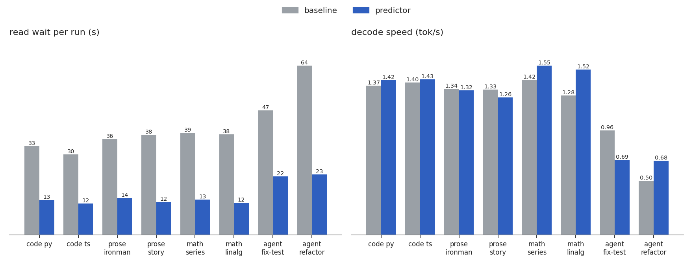

# moe-prefetch

predicts which experts the next layers of [qwen3.8-flash-next](https://github.com/DimitriChrysafis/qwen3.8-flash-next) will need, and reads them off the ssd early. it patches the engine at runtime, so the engine repo is unchanged.

## why

each of the 48 moe layers picks 10 of 512 experts per token. the engine only learns which ones after that layer's router runs, so every read waits on the ssd. a small predictor looks at the hidden state entering layer L and starts reads for layers L+1 to L+3 while L is still computing.

## results



8 prompts the predictor never trained on, 128 tokens each, one run per prompt. m3 max, 36 gb, 8 gib expert cache. raw data in `artifacts/bench/20261006-125327.json`.

- read wait drops 53 to 68% on every prompt. the median goes from 37.9 s to 13.3 s.
- 45 to 62% of prefetched experts get used. without the predictor, under 1.1%.
- decode goes up on 5 prompts and down on 3. the median goes from 1.33 to 1.37 tok/s.
- every prompt produces the same tokens with and without the predictor.

saving wait time didn't make decode faster. agent-fix-test dropped from 0.96 to 0.69 tok/s.

## offline recall

on the held-out prompts, the predictor's top 10 contains the experts a layer really uses 67% of the time, one layer ahead. the engine's frequency heuristic gets 22%. the untrained router alone gets 63%.

## what didn't work

- without pinning, the cache evicts prefetched experts before they're used. hit rate falls to 8%, and decode drops to 1.06 tok/s against 1.35 without prefetch (six non-agent prompts).
- less waiting didn't mean faster decode. bytes read went up on 7 of 8 prompts, because wrong guesses add reads. I suspect building mlx arrays on the main thread takes the rest.
- the simulator was too optimistic. it predicted 1.54 to 3.68 tok/s from split reads. the real model gained about 7%. the simulator doesn't model python or mlx overhead.
- long prefills got slower. agent-fix-test's time to first token went from 47 s to 80 s. I suspect parallel reads on long prefills. next step is limiting them to decode.

## layout

- `scripts/record_traces.py`: routed experts for 30 prompts
- `scripts/train_predictors.py`: one head per layer and lookahead
- `scripts/eval_predictors.py`: recall on held-out prompts
- `scripts/simulate.py`: replays traces without loading the model
- `scripts/bench.py`: baseline vs predictor, fresh process per run
- `moe_prefetch.runtime`: the hook that submits the reads

## run it

```sh
python -m venv .venv && source .venv/bin/activate
pip install -e ../qwen3.8-flash-next
pip install -e '.[dev]'
pytest
```

scripts default to `~/qwen3.8next/models/pipenetwork-Qwen3.8-Flash-Next-MLX-4bit`. use `--model` to change it. run one model process at a time, or the ssd contention ruins the timings.

```sh
python scripts/record_traces.py
python scripts/train_predictors.py --name linear
python scripts/eval_predictors.py heuristic future_gate linear
python scripts/bench.py --mode baseline predictor --predictor artifacts/predictors/linear \
  --opt k=8 --opt 'lookaheads=[1,2]' --opt protect=true --opt parallel_demand=true \
  --split eval --max-tokens 128 --compare
```

## tests

37 tests. the runtime hook must produce identical tokens and logits with prefetch on and off.
